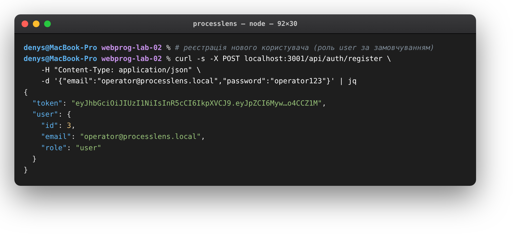
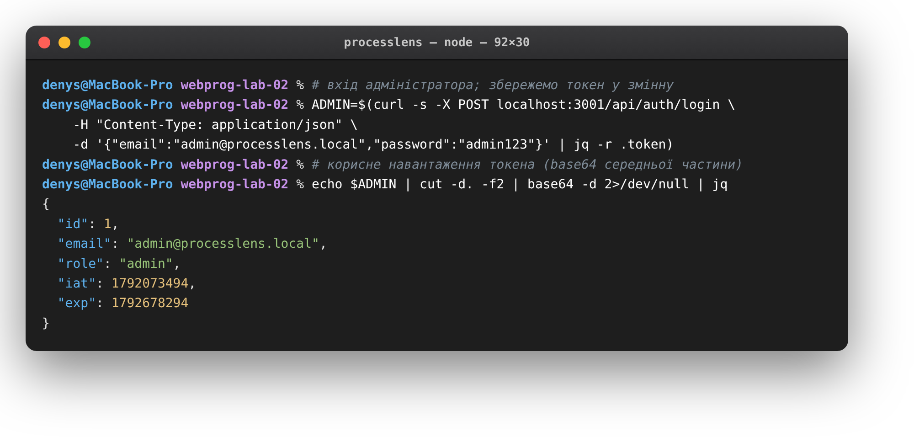
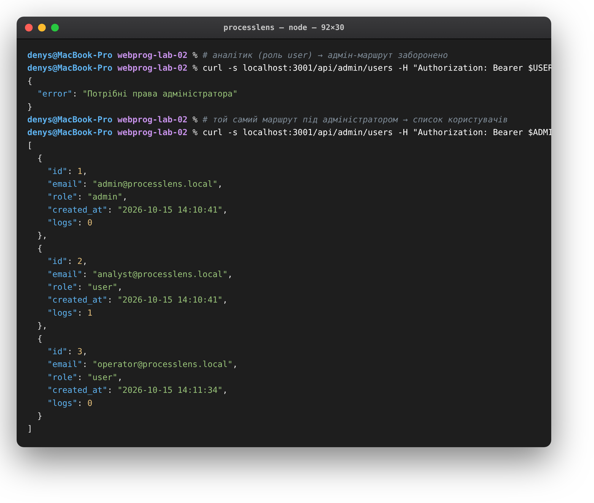
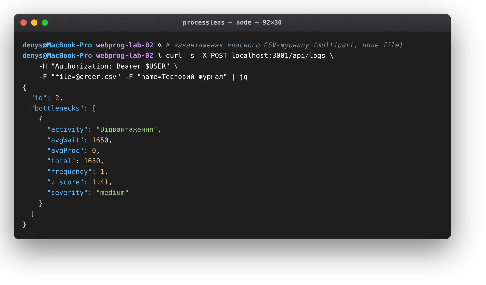
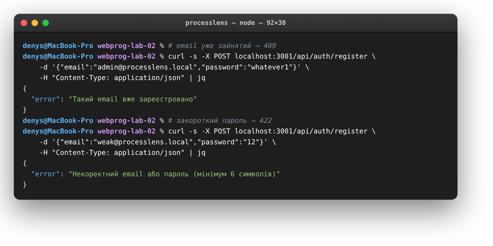

# ProcessLens · автентифікація та доступ

> Лабораторна робота №2 — **Вебпрограмування**
> Виконав: **Коваль Денис**

| | |
|---|---|
| **Застосунок** | ProcessLens — пошук «вузьких місць» у бізнес-процесах |
| **Тема** | автентифікація, авторизація, завантаження файлів |
| **Стек** | Node.js · Express · SQLite · JWT · bcrypt · multer |
| **Порт** | `3001`, префікс `/api` |

---

## Що це

Друга робота розширює серверну частину ProcessLens механізмами безпеки: реєстрацією та входом користувачів за токенами, розмежуванням доступу за ролями та завантаженням журналів у вигляді файлів. Мета — навчитися будувати захищений REST API, де кожен запит проходить перевірку особи й прав, а зовнішні дані надійно валідуються.

## Автентифікація

Користувач реєструється (`POST /api/auth/register`) або входить (`POST /api/auth/login`), а сервер у відповідь видає **JWT** із терміном дії 7 днів. У корисному навантаженні токена — ідентифікатор, email і роль користувача. Пароль ніколи не зберігається у відкритому вигляді: при реєстрації він хешується алгоритмом **bcrypt**, а при вході звіряється з хешем.

Для доступу до захищених маршрутів клієнт надсилає токен у заголовку `Authorization: Bearer <token>`. Проміжний обробник `requireAuth` перевіряє підпис і термін дії токена й додає дані користувача до запиту; за відсутності або недійсності токена повертається `401`.

## Авторизація за ролями

Кожен користувач має роль — `user` або `admin`. Адміністративні маршрути (`/api/admin/*`) додатково захищено обробником `requireAdmin`, який пропускає лише користувачів із роллю `admin`, інакше повертає `403`. Так, список усіх користувачів і видалення облікових записів доступні тільки адміністраторові, тоді як робота з власними журналами — будь-якому автентифікованому користувачу.

## Завантаження файлів

Журнали подій завантажуються як файли через `POST /api/logs` (multipart, поле `file`). Приймання бере на себе **multer** з обмеженням розміру 10 МБ; завантажений CSV синтаксично розбирається, перевіряється на наявність обов'язкових колонок (`case_id`, `activity`, `ts`), зберігається в базі окремими подіями й одразу проганяється через аналіз. У відповідь клієнт отримує ідентифікатор журналу та перелік знайдених вузьких місць.

## Валідація та захист

- поля реєстрації/входу перевіряє **express-validator** (коректність email, довжина пароля ≥ 6);
- повторний email повертає `409`, закороткий пароль — `422`;
- маршрути автентифікації обмежено за частотою (**express-rate-limit**) — захист від перебору паролів;
- усі помилки мають єдиний формат `{ "error": "…" }` з відповідним HTTP-статусом.

## Маршрути

| Метод  | Шлях                   | Доступ            | Опис                              |
| ------ | ---------------------- | ----------------- | --------------------------------- |
| POST   | `/api/auth/register`   | публічний         | реєстрація, повертає JWT          |
| POST   | `/api/auth/login`      | публічний         | вхід, повертає JWT                |
| GET    | `/api/logs`            | автентифікований  | журнали користувача               |
| POST   | `/api/logs`            | автентифікований  | завантаження CSV-журналу          |
| DELETE | `/api/logs/:id`        | автентифікований  | видалення журналу                 |
| GET    | `/api/admin/users`     | admin             | список користувачів               |
| DELETE | `/api/admin/users/:id` | admin             | видалення користувача             |

## Запуск

```bash
cd backend
npm install
npm run seed     # демо-користувачі (admin + analyst) і демо-журнал
npm start        # http://localhost:3001
```

Демо-акаунти: `admin@processlens.local / admin123` (admin), `analyst@processlens.local / analyst123` (user).

## Демо

Реєстрація нового користувача — у відповідь JWT і профіль із роллю:



Вхід адміністратора й корисне навантаження токена (роль `admin`):



Розмежування доступу: той самий адмін-маршрут під `user` (403) і під `admin` (200):



Завантаження власного CSV-журналу з миттєвим аналізом:



Помилки реєстрації: зайнятий email (409) і закороткий пароль (422):



## Підсумок

Серверну частину ProcessLens доповнено повноцінним контуром безпеки: реєстрація та вхід видають JWT, паролі зберігаються лише у вигляді bcrypt-хешу, захищені маршрути перевіряють особу через `requireAuth`, а адміністративні — ще й роль через `requireAdmin`. Реалізовано завантаження журналів файлами з перевіркою формату й обмеженням розміру, а також валідацію вхідних даних і захист маршрутів входу від перебору. Запити без прав чи з хибними даними коректно відхиляються з відповідними статусами, що робить API придатним для багатокористувацької роботи.
